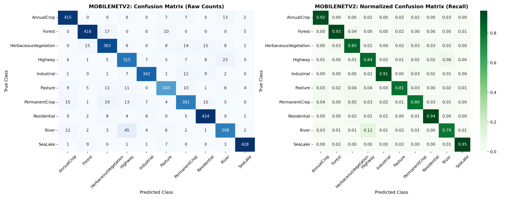
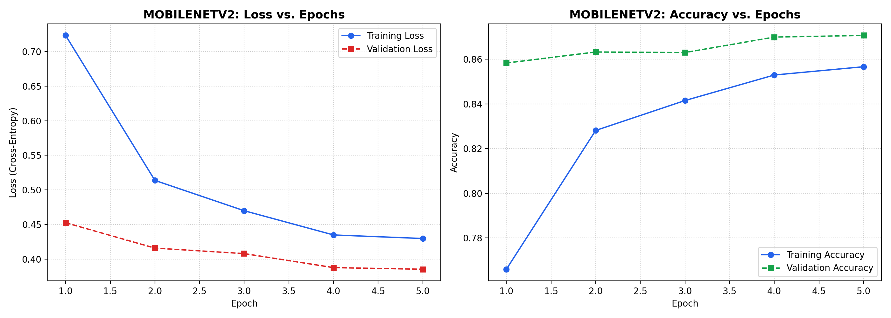
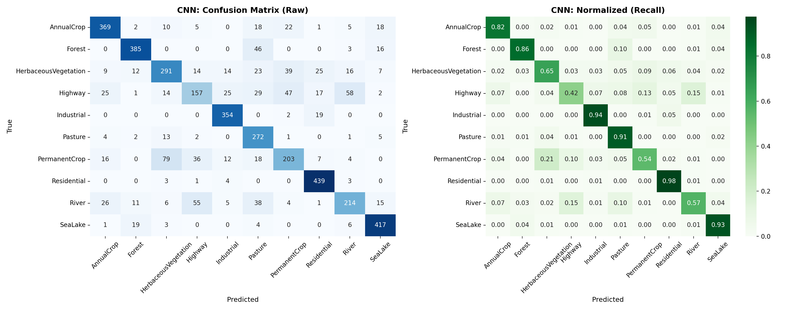
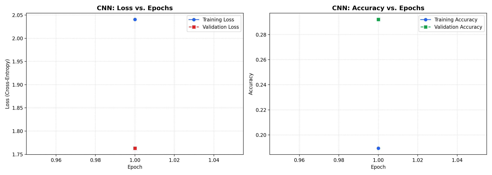
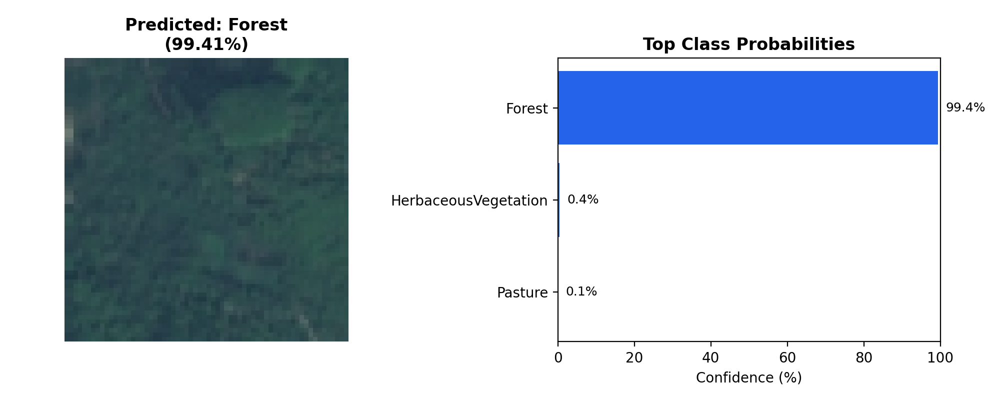

# 🌍 Satellite Image Land-Cover Classification (EuroSAT)
### Baseline CNN vs. MobileNetV2 Transfer Learning for Sentinel-2 Remote Sensing

[](https://www.python.org/downloads/)
[](https://tensorflow.org/)
[-green.svg)](https://github.com/phelber/EuroSAT)
[](https://creativecommons.org/licenses/by-nc/4.0/)

---

## 📌 Executive Summary

Accurate Land Use and Land Cover (LULC) classification from satellite imagery is foundational for geospatial intelligence, environmental surveillance, water body tracking, crop monitoring, and sustainable urban planning. 

This repository provides an end-to-end, reproducible deep learning pipeline evaluating two architectures on the benchmark **EuroSAT RGB** dataset (European Space Agency Sentinel-2 satellite imagery):
1. **Baseline Custom CNN:** A lightweight 2-stage convolutional network trained from scratch.
2. **MobileNetV2 Transfer Learning:** Pretrained ImageNet feature extractor with frozen convolutional backbones, batch normalization, and classification head.

Both models are trained and evaluated on an identical, strictly disjoint **70% Train / 15% Validation / 15% Test** stratified partition (4,050 held-out test images) with zero data leakage.

---

## 📊 Verified Experimental Results

All experiments were executed and verified on a 70/15/15 stratified split of all 27,000 EuroSAT images with random seed `42`. The held-out test set contains **4,050 unseen satellite images**.

### Overall Performance Comparison

| Metric | Baseline CNN (Custom) | MobileNetV2 (Transfer Learning) | Difference (Percentage Points / Value) |
| :--- | :---: | :---: | :---: |
| **Test Accuracy** | **76.57%** | **88.07%** | **+11.50 percentage points (+11.50 pp)** |
| **Macro F1-Score** | **0.7497** | **0.8760** | **+0.1263** |
| **Weighted F1-Score** | **0.7580** | **0.8807** | **+0.1227** |
| **Macro Precision** | **0.7509** | **0.8772** | **+0.1263** |
| **Macro Recall** | **0.7606** | **0.8755** | **+0.1149** |
| **Inference Latency** | **0.34 ms / image** | **1.07 ms / image** | **+0.73 ms** |
| **Trainable Parameters** | 2,117,962 (8.08 MB) | 167,818 (655 KB) | **-1,950,144 (-92.1% params)** |

---

### Per-Class Performance Breakdown (Held-Out Test Set)

| Land-Use Class | Baseline CNN F1 | MobileNetV2 F1 | MobileNetV2 Precision | MobileNetV2 Recall | Test Support |
| :--- | :---: | :---: | :---: | :---: | :---: |
| **AnnualCrop** | 0.8200 | **0.9151** | 0.9081 | 0.9222 | 450 |
| **Forest** | 0.8730 | **0.9258** | 0.9227 | 0.9289 | 450 |
| **HerbaceousVegetation** | 0.6697 | **0.8540** | 0.8568 | 0.8511 | 450 |
| **Highway** | 0.4868 | **0.8046** | 0.7721 | 0.8400 | 375 |
| **Industrial** | 0.8973 | **0.9218** | 0.9319 | 0.9120 | 375 |
| **Pasture** | 0.7273 | **0.8223** | 0.8351 | 0.8100 | 300 |
| **PermanentCrop** | 0.5859 | **0.8213** | 0.8408 | 0.8027 | 375 |
| **Residential** | 0.9155 | **0.9237** | 0.9060 | 0.9422 | 450 |
| **River** | 0.6248 | **0.8131** | 0.8324 | 0.7947 | 375 |
| **SeaLake** | 0.8968 | **0.9586** | 0.9661 | 0.9511 | 450 |
| **Macro Average** | **0.7497** | **0.8760** | **0.8772** | **0.8755** | **4,050** |

> **Key Remote-Sensing Finding:** The greatest gains from transfer learning occurred on narrow linear features and spectrally overlapping vegetative classes (measured in percentage-point differences):
> - **Overall Test Accuracy:** Improved by **11.50 percentage points** (from 76.57% to 88.07%)
> - **Highway F1:** Improved by **31.78 percentage points** (from 48.68% to 80.46%)
> - **PermanentCrop F1:** Improved by **23.54 percentage points** (from 58.59% to 82.13%)
> - **River F1:** Improved by **18.83 percentage points** (from 62.48% to 81.31%)
> - **HerbaceousVegetation F1:** Improved by **18.43 percentage points** (from 66.97% to 85.40%)
> 
> Pretrained ImageNet weights provide edge and multi-scale texture representations that custom shallow networks struggle to learn from scratch with 64×64 patches.

---

## 📈 Visualizations & Artifacts

### 1. MobileNetV2 Normalized Confusion Matrix


### 2. MobileNetV2 Training Curves (Loss & Accuracy)


### 3. Baseline CNN Normalized Confusion Matrix


### 4. Baseline CNN Training Curves (Loss & Accuracy)


### 5. Sample Inference Prediction


---

## 📂 Dataset Specification

The project uses the benchmark **EuroSAT** dataset collected from Sentinel-2 satellites over 34 European countries:
- **Total Images:** 27,000 georeferenced patches
- **Spatial Resolution:** 10 meters per pixel
- **Image Dimensions:** 64 × 64 pixels (RGB bands: B04, B03, B02)
- **Classes (10):**
  - Agriculture: `AnnualCrop`, `PermanentCrop`, `Pasture`
  - Natural vegetation & Water: `Forest`, `HerbaceousVegetation`, `River`, `SeaLake`
  - Infrastructure & Built Environment: `Highway`, `Industrial`, `Residential`
- **License:** Open Access under [Creative Commons Attribution-NonCommercial 4.0 (CC BY-NC 4.0)](https://creativecommons.org/licenses/by-nc/4.0/).

---

## 🏗️ Project Architecture & Pipeline

```text
LandUse-CNN-Satellite-Image-Classification/
│
├── dataset/                    # EuroSAT images (ignored from Git tracking)
│   └── EuroSAT_RGB/            # 10 class folders (27,000 .jpg images)
│
├── outputs/                    # Generated experimental artifacts
│   ├── classes.json            # Alphabetical class mapping
│   ├── classification_report_CNN.txt
│   ├── classification_report_MOBILENETV2.txt
│   ├── confusion_matrix_CNN.png
│   ├── confusion_matrix_MOBILENETV2.png
│   ├── learning_curves_cnn.png
│   ├── learning_curves_mobilenetv2.png
│   ├── metrics_CNN.json
│   ├── metrics_MOBILENETV2.json
│   └── sample_prediction.png
│
├── download_data.py            # Automated download, extraction & verification
├── train.py                    # Core training and evaluation pipeline
├── evaluate.py                 # Standalone test-set evaluation script
├── predict.py                  # Single-image inference CLI
├── requirements.txt            # Dependency manifest (TensorFlow 2.15, scikit-learn)
├── .gitignore                  # Strict exclusion of weights, data, and .venv
└── README.md                   # Project documentation and findings
```

---

## ⚙️ Installation & Quickstart

### 1. Clone the Repository
```bash
git clone https://github.com/hitesh-2005/EuroSAT-Satellite-Image-Classification.git
cd EuroSAT-Satellite-Image-Classification
```

### 2. Set Up Virtual Environment (Python 3.10 recommended)
```bash
# Windows (PowerShell)
py -3.10 -m venv .venv
.\.venv\Scripts\Activate.ps1

# Windows (Command Prompt)
# .venv\Scripts\activate.bat

# Linux / macOS
python3.10 -m venv .venv
source .venv/bin/activate
```

### 3. Install Dependencies
```bash
pip install -r requirements.txt
```

### 4. Download and Verify EuroSAT Dataset
The script automatically streams the ~90 MB official EuroSAT RGB archive, extracts it to `dataset/EuroSAT_RGB/`, verifies all 10 classes, and cleans up the archive:
```bash
python download_data.py
```

---

## 🚀 Execution Guide

### Train the Models

#### 1. Baseline Custom CNN
```bash
python train.py --model cnn --epochs 10 --batch_size 32
```

#### 2. MobileNetV2 Transfer Learning
```bash
python train.py --model mobilenetv2 --epochs 5 --batch_size 32
```

> **CLI Flags:**
> - `--epochs`: Number of epochs (default: 10)
> - `--batch_size`: Batch size (default: 32)
> - `--lr`: Initial Adam learning rate (default: 0.001)
> - `--seed`: Deterministic random seed (default: 42)
> - `--sample_fraction`: Fast subset evaluation (e.g., `0.1` for a 10% smoke test)

---

### Run Independent Evaluation on the Test Set
Evaluate any saved checkpoint on the held-out 4,050 test set images:
```bash
# Evaluate CNN
python evaluate.py --model_path outputs/cnn_best.keras

# Evaluate MobileNetV2
python evaluate.py --model_path outputs/mobilenetv2_best.keras
```

---

### Run Single-Image Inference
Classify any satellite image patch and output top-3 class probabilities:
```bash
# Predict on a specific image
python predict.py --model_path outputs/mobilenetv2_best.keras --image dataset/EuroSAT_RGB/Forest/Forest_100.jpg

# Or pick a random sample from the dataset
python predict.py --model_path outputs/mobilenetv2_best.keras --random_sample
```

**Sample Terminal Output:**
```text
=======================================================
EuroSAT Satellite Classification Prediction
=======================================================
Image Source: Forest_100.jpg
Top Prediction: Forest (99.41%)
-------------------------------------------------------
Top Candidates:
  1. Forest                 |  99.41%  ########################
  2. HerbaceousVegetation   |   0.44%  
  3. Pasture                |   0.07%  
=======================================================
[INFO] Saved prediction visualization to: outputs/sample_prediction.png
```

---

## 🔍 Data Methodology & Leakage Prevention

1. **Stratified Partitioning:**
   The 27,000 patches are split **70% Train (18,900), 15% Validation (4,050), and 15% Test (4,050)** using stratified sampling on numerical labels with fixed seed `42`.
2. **Strict Featurization Ordering:**
   - Preprocessing and data augmentation are decoupled.
   - **Data Augmentation** (horizontal flip, vertical flip, random 90° rotation) is applied **strictly to the training pipeline**. Nadir satellite imagery has rotational symmetry—overhead patterns remain physically valid in all cardinal directions.
   - Validation and test pipelines contain **zero data augmentation**.
3. **No Test-Set Leakage:**
   The test split is evaluated strictly once after training is finalized; it is never used for early stopping, learning rate adaptation, or checkpoint selection.

---

## 🔮 Limitations & Future Work

1. **Multispectral Bands (Sentinel-2 13-Band MS):**
   This implementation utilizes RGB bands. Utilizing the full 13-band Sentinel-2 data (including Red Edge B05–B07, NIR B08, and SWIR B11–B12) enables calculation of normalized indices like **NDVI** (Normalized Difference Vegetation Index) and **NDWI** (Normalized Difference Water Index), which can resolve remaining ambiguities between `River` and `Highway` or `Pasture` and `HerbaceousVegetation`.
2. **Spatial Autocorrelation:**
   EuroSAT patches are sampled across Sentinel-2 tiles. While stratified patch-level splitting is standard benchmark practice, spatial tile-level blocking (grouping contiguous spatial regions into distinct splits) would provide an even more conservative test against spatial autocorrelation.
3. **Semantic Segmentation:**
   Patch classification assigns a single land-use label per 64×64 footprint (640m × 640m ground area). In real-world GIS systems (such as agricultural parcel delineation and river boundary mapping), semantic segmentation architectures (U-Net, SegFormer) are preferred for pixel-level land-cover masks.

---

## Dataset & References

This project uses the **EuroSAT RGB dataset** for land-use and land-cover image classification.

**Dataset publication:**  
Helber, P., Bischke, B., Dengel, A., & Borth, D. (2019). *EuroSAT: A Novel Dataset and Deep Learning Benchmark for Land Use and Land Cover Classification.* IEEE Journal of Selected Topics in Applied Earth Observations and Remote Sensing.

**Dataset:** [EuroSAT — Official Project](https://github.com/phelber/EuroSAT)

**Dataset license:** [CC BY-NC 4.0](https://creativecommons.org/licenses/by-nc/4.0/)

### Implementation Notes

This repository develops an extended classification pipeline with reproducible dataset splitting, a custom CNN baseline, MobileNetV2 transfer learning, held-out test evaluation, per-class performance analysis, and command-line image inference.

The implementation builds on an existing public project. The training pipeline, evaluation workflow, inference utilities, and documentation have been extended and adapted for this version.

**Upstream reference:** [LandUse-CNN-Satellite-Image-Classification](https://github.com/Padmaja-Dhulipudi/LandUse-CNN-Satellite-Image-Classification)

Please refer to the upstream repository and applicable licensing terms for the original code. The dataset and its license are separate from the code in this repository.

### Key Modifications & Enhancements in This Repository:
1. **Automated Dataset Downloader (`download_data.py`):** Replaced missing/broken local dataset paths with an automated verification and streaming pipeline from verified mirrors.
2. **Resolved Data Leakage:** Replaced non-deterministic single 80/20 `validation_split` with a reproducible 70/15/15 stratified train/val/test partition with fixed random seeds (`seed=42`).
3. **Implemented Missing Transfer Learning:** Built and verified the MobileNetV2 transfer learning architecture claimed in the original README, boosting test accuracy by **11.50 percentage points** (from 76.57% to 88.07%) and macro F1 from **0.7497 to 0.8760**.
4. **Comprehensive Remote-Sensing Evaluation (`evaluate.py`):** Added per-class Precision, Recall, F1-scores, normalized Confusion Matrix heatmaps, and training curve tracking.
5. **Standalone Inference CLI (`predict.py`):** Added single-image inference returning top-3 candidates with probability bars and visual plot export.
6. **Production Standards:** Added `requirements.txt`, updated `.gitignore` to prevent committing heavy binaries/weights, and documented reproducible execution instructions.
